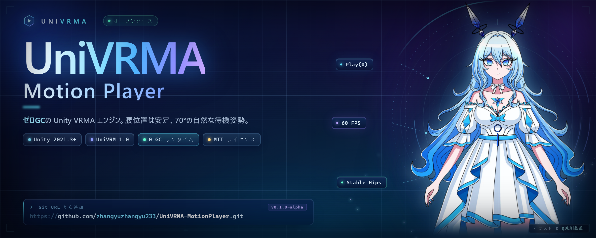

# UniVRMA Motion Player

[English](README.md) · [简体中文](README.zh-CN.md) · **日本語**

### `.vrma` を VRM 1.0 モデルにドロップする。それだけで動く。足は床につき、腕は 70°、GC はゼロ。

UniVRM がリターゲティングなら、**これはプレイヤー。**

`UniVRMA Motion Player` は **Unity + UniVRM 1.0** に足りなかった再生レイヤーです。
`VrmaPlayer` コンポーネント 1 つで、公式のアニメーションパイプラインを「そのまま
プロジェクトに出せる状態」にします。シーンで安全、体格差に安全、割り当てゼロ。
そして停止したとき、キャラクターはちゃんと人間の姿勢で立ちます。

[](https://unity.com/)
[](https://github.com/vrm-c/UniVRM)
[](Packages/com.univrma.motionplayer/CHANGELOG.md)
[](#本当にゼロgcなのか)
[](LICENSE)



---

## ある / ない

| VRMA 組み込み初日の午後 | `VrmaPlayer` を付けた後 |
| :--- | :--- |
| シーンで Play した瞬間 `NullReferenceException` | スクリプトが ControlRig を自分で構築 |
| 1.35 m のモデルが 12 cm 浮く。あるいは床に埋まる | 毎フレーム、腰をモデル自身の安静高さへ再アンカー |
| 再生が 180° 反転／逆さまになる | クリップはワールド原点の独立 `[VRMA_Pool]` に隔離 |
| `Stop()` で骨格が 90° の T-Pose に戻る | 70°の自然な腕の垂れを、アニメーションと IK の**後に**適用 |
| ルートモーションが Transform 階層と喧嘩する | プールはアバター階層から完全に分離 |

上流の 5 つの不具合を、コンポーネント 1 つで。エディタ拡張の記述は不要です。

---

## 導入する理由

- **ゼロGC、本当に。** `Play(int)` は `Vrm10Instance.Runtime.VrmAnimation` のポインタを
  差し替えるだけ。`Instantiate` もクロージャも LINQ もありません。Profiler の
  **GC Alloc は 0 B**。
- **体格を選ばない。** ロリ・少女・成人が同じクリップを共有しても、片方が浮いて
  片方が沈むことはありません。腰は*アバター自身*の基準に固定されます。
- **デフォルトで人間らしい。** 70°の腕の角度（30〜90°で調整可）を `LateUpdate` で適用。
  アニメーション・IK・Look-At と競合せず、確実に上書きします。
- **ホットスワップ可能。** ダウンロードしたクリップ、Addressables、Mod フォルダから
  読み込んだクリップを実行時に `Play(prefab)`。
- **デザイナーにも優しい。** プログラマは `event Action<int>`、テクニカルアーティストは
  Inspector で `UnityEvent<int>` を接続して音声・VFX を叩けます。
- **とにかく小さい。** ランタイムスクリプト 2 本、エディタ 1 本、依存は UniVRM 1.0 のみ。

---

## インストール

**Package Manager → Add package from git URL**（推奨）

```text
https://github.com/zhangyuzhangyu233/UniVRMA-MotionPlayer.git?path=Packages/com.univrma.motionplayer#v0.1.0-alpha
```

<details>
<summary>他の 2 つの方法</summary>

**ターボール**：[Releases](https://github.com/zhangyuzhangyu233/UniVRMA-MotionPlayer/releases) から
`com.univrma.motionplayer-0.1.0-alpha.tgz` を取得し、*Add package from tarball* で追加。

**従来の `.unitypackage`**：`UniVRMA_MotionPlayer_v0.1.0-alpha.unitypackage` を
ダウンロードしてダブルクリック。`Assets/UniVRMA Motion Player/` に展開されます。

</details>

| 要件 | バージョン |
| :--- | :--- |
| Unity | 2021.3 LTS 以降（2022.3 / Unity 6 も同一 API） |
| UniVRM | `com.vrmc.vrm` 0.120.0+（VRM 1.0） |
| パイプライン | Built-in · URP · HDRP — シェーダーには触れません |

> VRMA は VRM 1.0 の機能です。VRM 0.x のアバターには対応していません。

---

## 30 秒クイックスタート

1. `Vrm10Instance` を持つオブジェクト（親でも可）に **`VrmaPlayer`** を追加；
2. `.vrma` プレハブを Inspector の **VRMA Prefabs** にドラッグ；
3. Play Mode に入り、カスタム Inspector の **Play** を押す。

```csharp
using UniVRMA;

var player = avatar.GetComponent<VrmaPlayer>();   // または [SerializeField]

player.OnClipStarted += i => Debug.Log($"▶ {i}");
player.Play(0);        // インデックス指定：文字列なし、割り当てなし
player.Stop();         // 70°の自然な待機姿勢へ

player.Play(runtimeVrmaPrefab);   // 実行時に読み込んだクリップをホットプラグ
```

---

## API

依存すべきは `IVrmaPlayer` だけです。

| メンバー | 型 | 説明 |
| :--- | :--- | :--- |
| `CurrentIndex` | `int` | 再生中クリップ。停止中は `-1` |
| `IsPlaying` | `bool` | 再生中か |
| `ClipCount` | `int` | プール内のクリップ数 |
| `ArmRestAngle` | `float` | 腕の角度。既定 **70°** |
| `Play(int)` | `void` | 番号指定で再生 |
| `Play(GameObject)` | `void` | 実行時プレハブを再生。プールは自動拡張 |
| `PlayByName(string, bool)` | `void` | 名前の部分一致（大文字小文字を無視） |
| `Stop()` | `void` | アニメーションを解除し待機姿勢へ |
| `ResetToRestPose()` | `void` | 即座に 70° を適用 |
| `OnClipStarted` / `OnClipStopped` | `event Action<int>` | ボックス化なしの C# イベント |
| `OnClipStartedEvent` / `OnClipStoppedEvent` | `UnityEvent<int>` | Inspector 接続イベント |

---

## 内部で起きていること

```
Vrm10Instance.Runtime
├── ControlRig   ← StableHipsPoseProvider(デコレータ) ← InitRotationPoseProvider
└── VrmAnimation ← Vrm10AnimationInstance   （Play() がポインタを差し替え、割り当てなし）

[VRMA_Pool]      （ワールド原点、アバター階層の外）
├── VRMA_Inst_1_Greeting
└── VRMA_Inst_2_Wave
```

`Play()` は 4 つだけ。前の `Animation` を停止し、前のインスタンスを無効化し、
`Runtime.VrmAnimation` を新しいインスタンスへ向け、`Rewind()` と `Play()` を呼ぶ。
ウォームアップ後は `Instantiate` しません。

## 本当にゼロGCなのか

「ゼロGC」はたいてい「見えないところに割り当てを移した」という意味です。ここは違います。

- ホットパスにインターフェースの `foreach`、LINQ、文字列連結はありません；
- `GetComponent` はクリップ切り替え時の 1 回だけ。毎フレームは呼びません；
- 空の `Action<int>` 呼び出しは null チェックとデリゲート呼び出しのみ。ボックス化なし；
- 10 秒で検証：Profiler → **GC Alloc** → `VrmaPlayer.Play` で絞り込み → **0 B**。

---

## FAQ

**UniVRM があるのに、なぜ必要？**
リターゲティングは優秀です。でもクリップのライフサイクル——プーリング、シーン
インスタンスのリグ初期化、腰のアンカー、待機姿勢、ルートモーションの隔離——は管理して
くれません。それがこのパッケージの仕事です。

**自分のモデルで動く？**
VRM 1.0 で、UniVRM のサンプルで `.vrma` が再生できるモデルなら動きます。体格差は設計で
吸収します。極端なプロポーションは実機で確認し、最小再現付きで Issue をください。

**クリップ間のクロスフェードは？**
未対応です（ハードカット）。`CrossFade` は 0.2 のロードマップにあります。

**ビルド / IL2CPP / Quest で動く？**
動きます。UniVRM の公開 API に対する純粋な C# で、ランタイムアセンブリにエディタ型は
含まれていません。

**なぜ alpha？**
API は小さく安定していますが、1.0 までに名前が変わる可能性があります。タグを固定して
ください。

---

## 既知の制限

- VRM 1.0 専用。VRM 0.x は非対応；
- クロスフェード未対応；
- `PlayByName` は呼び出し時に文字列比較を行うため、ホットパスでは `Play(int)`；
- 70° の姿勢は腕のみ。全身の待機は Idle クリップで。

---

## コントリビュート

最小再現（VRM 1 体 + VRMA 1 本）付きのバグ報告が、何より価値があります。

- [バグ報告](.github/ISSUE_TEMPLATE/bug_report.yml)
- [機能リクエスト](.github/ISSUE_TEMPLATE/feature_request.yml)
- [変更履歴](Packages/com.univrma.motionplayer/CHANGELOG.md)

---

## ライセンスとクレジット

- **コード**：[MIT](LICENSE)。商用利用・改変・再配布は自由です。
- **バナーイラスト**：キャラクター **氷川藍 / Glacier Blue**、イラスト
  **© 2026 冰川蓝蓝 — All Rights Reserved**。イラストは MIT の対象**外**で、
  本プロジェクトの告知にのみ使用しています。再利用前に [NOTICE.md](NOTICE.md) を
  ご確認ください。

午後ひとつ分助かったなら：**Star をいただけると幸いです**。そして、同じ接着コードを書き直そうと
している誰かに教えてあげてください。
