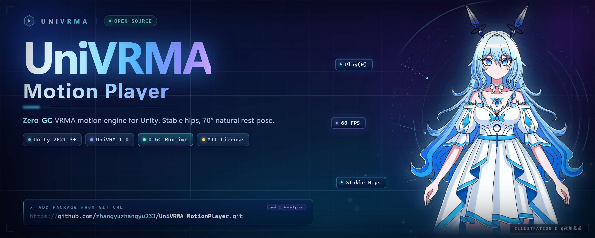

# UniVRMA Motion Player

**English** · [简体中文](README.zh-CN.md) · [日本語](README.ja.md)

### Drop a `.vrma` on a VRM 1.0 avatar. It plays. Feet on the floor, arms at 70°, zero GC.

UniVRM gives you the retargeting. **This gives you the player.**

`UniVRMA Motion Player` is the missing playback layer for **Unity + UniVRM 1.0** — one
`VrmaPlayer` component that turns the official animation pipeline into something you can
actually ship: scene-safe, height-safe, allocation-free, and warm enough to look human
when the clip stops.

[](https://unity.com/)
[](https://github.com/vrm-c/UniVRM)
[](Packages/com.univrma.motionplayer/CHANGELOG.md)
[](#but-is-it-really-zero-gc)
[](LICENSE)



---

## Before / after

| The first afternoon of every VRMA integration | After dropping in `VrmaPlayer` |
| :--- | :--- |
| `NullReferenceException` the moment you press Play on a scene-placed prefab | Scripts initialize the control rig themselves |
| Your 1.35 m avatar hovers 12 cm above the floor — or buries its feet | Hips re-anchored to the model's own rest height, every frame |
| Playback comes out 180° flipped / upside down | Clips live in an isolated `[VRMA_Pool]` at the world origin |
| `Stop()` snaps the skeleton into a 90° T-pose | A 70° natural arm drape, applied *after* animation and IK |
| Root motion fights your Transform hierarchy | Pool is fully decoupled from the avatar |

Five upstream papercuts. One component. No editor tooling required.

---

## Why you'll care

- **Zero GC, honestly.** `Play(int)` swaps the `Vrm10AnimationInstance` pointer on
  `Vrm10Instance.Runtime` — no `Instantiate`, no closures, no LINQ. Clip switching is a
  boolean toggle. Watch `GC Alloc` in the Profiler: **0 B**.
- **Height-agnostic.** A loli, a teen and an adult can share the same clip without one
  floating and one sinking. The hips are anchored to *the avatar's* baseline, not the
  animation's.
- **Human by default.** 70° arm drape (configurable 30–90°) in `LateUpdate`, so it beats
  animation, IK and look-at instead of fighting them.
- **Hot-swappable.** Clips can be injected at runtime — downloaded, Addressables-loaded,
  or dragged from a mod folder.
- **Designer-friendly.** Programmers get `event Action<int>`; tech artists get
  `UnityEvent<int>` wired in the Inspector for audio and VFX.
- **Tiny.** Two runtime scripts, one editor script, one peer dependency (UniVRM 1.0).

---

## Install

**UPM → Add package from git URL** (recommended)

```text
https://github.com/zhangyuzhangyu233/UniVRMA-MotionPlayer.git?path=Packages/com.univrma.motionplayer#v0.1.0-alpha
```

<details>
<summary>Other two ways</summary>

**Tarball** — grab `com.univrma.motionplayer-0.1.0-alpha.tgz` from
[Releases](https://github.com/zhangyuzhangyu233/UniVRMA-MotionPlayer/releases) and use
*Add package from tarball*.

**Legacy `.unitypackage`** — download `UniVRMA_MotionPlayer_v0.1.0-alpha.unitypackage`
and double-click it. Scripts land in `Assets/UniVRMA Motion Player/`.

</details>

| Requirement | Version |
| :--- | :--- |
| Unity | 2021.3 LTS+ (2022.3 / Unity 6 use the same API shape) |
| UniVRM | `com.vrmc.vrm` 0.120.0+ (VRM 1.0) |
| Pipeline | Built-in · URP · HDRP — no shaders touched |

> VRMA is a VRM 1.0 feature. VRM 0.x avatars are not supported.

---

## 30-second quick start

1. Add **`VrmaPlayer`** to the object with `Vrm10Instance` (a parent works too).
2. Drag your `.vrma` prefabs into **VRMA Prefabs**.
3. Press Play. Hit **Play** in the custom Inspector.

```csharp
using UniVRMA;

var player = avatar.GetComponent<VrmaPlayer>();   // or [SerializeField]

player.OnClipStarted += i => Debug.Log($"▶ {i}");
player.Play(0);        // index-based: no string, no allocation
player.Stop();         // returns to the 70° rest pose

player.Play(runtimeVrmaPrefab);   // hot-plug a clip loaded at runtime
```

---

## API

Depend on `IVrmaPlayer` and nothing else.

| Member | Type | What it does |
| :--- | :--- | :--- |
| `CurrentIndex` | `int` | Playing clip, `-1` when idle |
| `IsPlaying` | `bool` | Is a clip active |
| `ClipCount` | `int` | Clips in the pool |
| `ArmRestAngle` | `float` | Natural drape angle, default **70°** |
| `Play(int)` | `void` | Play by index |
| `Play(GameObject)` | `void` | Play a runtime prefab, pool auto-expands |
| `PlayByName(string, bool)` | `void` | Case-insensitive name match |
| `Stop()` | `void` | Clear animation, return to rest pose |
| `ResetToRestPose()` | `void` | Force the 70° pose now |
| `OnClipStarted` / `OnClipStopped` | `event Action<int>` | Zero-boxing C# events |
| `OnClipStartedEvent` / `OnClipStoppedEvent` | `UnityEvent<int>` | Inspector-wired events |

---

## What's actually happening

```
Vrm10Instance.Runtime
├── ControlRig   ← StableHipsPoseProvider(decorator) ← InitRotationPoseProvider
└── VrmAnimation ← Vrm10AnimationInstance   (pointer swapped by Play(), no alloc)

[VRMA_Pool]      (world origin, outside the avatar hierarchy)
├── VRMA_Inst_1_Greeting
└── VRMA_Inst_2_Wave
```

`Play()` stops the previous `Animation`, disables the previous instance, points
`Runtime.VrmAnimation` at the new one, then rewinds and plays. Nothing is instantiated
after warm-up.

## But is it *really* zero GC?

Fair question — "zero GC" usually means "we moved the allocation somewhere you can't see".

- No `foreach` over interfaces, no LINQ, no string formatting on the hot path.
- `GetComponent` lookups happen once per clip switch, never per frame.
- Firing an `Action<int>` is a null check and a delegate call — no boxing.
- Verify it in ten seconds: Profiler → **GC Alloc** → filter `VrmaPlayer.Play` → **0 B**.

---

## FAQ

**Doesn't UniVRM already do this?**
It retargets beautifully. It does not own the clip lifecycle: pooling, scene-instance rig
initialization, hips anchoring, rest pose, or root-motion isolation. That's this package.

**Will it work with my model?**
If it is VRM 1.0 and plays a `.vrma` in UniVRM's own sample, yes. Bodies of different
heights are handled by design; extreme proportions are worth testing — file an issue with a
minimal repro.

**Can I blend between clips?**
Not yet — switching is a hard cut. `CrossFade` is on the roadmap for 0.2.

**Does it work in builds / IL2CPP / Quest?**
Yes. It's plain C# against UniVRM's public API, no editor-only types in the runtime assembly.

**Why alpha?**
The API is small and stable, but names may still shift before 1.0. Pin a tag.

---

## Known limits

- VRM 1.0 only; no VRM 0.x.
- No cross-fade yet.
- `PlayByName` compares strings on call — use `Play(int)` in hot paths.
- The 70° pose affects arms only; full-body idle belongs to an Idle clip.

---

## Contributing

Bug reports with a minimal repro (one VRM + one VRMA) are worth more than gold.

- 🐞 [Bug report](.github/ISSUE_TEMPLATE/bug_report.yml)
- ✨ [Feature request](.github/ISSUE_TEMPLATE/feature_request.yml)
- 📖 [Changelog](Packages/com.univrma.motionplayer/CHANGELOG.md)

---

## License & credits

- **Code:** [MIT](LICENSE) — commercial use, modification and redistribution are free.
- **Banner artwork:** character **Glacier Blue / 冰川蓝**, illustration
  **© 2026 @冰川蓝蓝 — All Rights Reserved**. The art is **not** MIT-licensed and is used
  only to present this project. Read [NOTICE.md](NOTICE.md) before reusing it.

If this saved you an afternoon: **⭐ the repo**, and tell one person who is about to
rewrite the same glue code.
