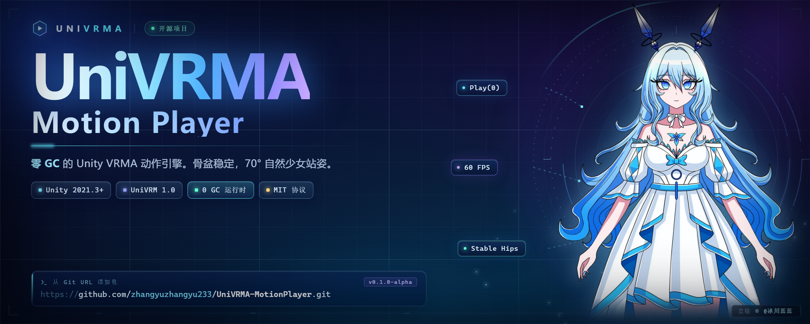

# UniVRMA Motion Player

[English](README.md) · **简体中文** · [日本語](README.ja.md)

### 把 `.vrma` 拖到 VRM 1.0 模型上，它就能播。脚踩实地，手臂 70°，零 GC。

UniVRM 负责重定向，**这个包负责能真正上线。**

`UniVRMA Motion Player` 是 **Unity + UniVRM 1.0** 缺失的那层播放层：一个 `VrmaPlayer`
组件，把官方动画管线变成能直接进项目的状态——场景安全、身高安全、零分配，而且停下来
的时候，人还是像个人。

[](https://unity.com/)
[](https://github.com/vrm-c/UniVRM)
[](Packages/com.univrma.motionplayer/CHANGELOG.md)
[](#真的零-gc-吗)
[](LICENSE)



---

## 有它 / 没它

| 每次接 VRMA 的第一个下午 | 挂上 `VrmaPlayer` 之后 |
| :--- | :--- |
| 场景里点 Play 的瞬间 `NullReferenceException` | 控制骨架由脚本自己补建 |
| 1.35 m 的萝莉悬空 12 cm，或者整个人陷进地板 | 每帧把骨盆重锚到模型自己的静息高度 |
| 播出来整个人翻了 180° / 倒着走 | 动作实例放在世界原点的独立 `[VRMA_Pool]` 里 |
| `Stop()` 之后骨架"啪"地弹成 90° T-Pose | 70° 自然下垂，在动画和 IK **之后**执行 |
| 根位移和你的 Transform 层级互相打架 | 对象池与角色层级彻底解耦 |

五个上游坑，一个组件，不用写编辑器脚本。

---

## 为什么值得装

- **零 GC，是认真的。** `Play(int)` 只改写 `Vrm10Instance.Runtime.VrmAnimation` 的指针——
  没有 `Instantiate`、没有闭包、没有 LINQ。切动作就是一个布尔开关。Profiler 里看
  **GC Alloc = 0 B**。
- **不挑身高。** 萝莉、少女、成人可以共用同一段动作，不会一个悬空一个陷地：骨盆锚的是
  *模型自己*的基准，不是动画的。
- **默认就像人。** 70° 手臂下垂（可调 30–90°）放在 `LateUpdate`，压过动画、IK 和
  Look-At，而不是跟它们抢。
- **动作可热插拔。** 下载的、Addressables 加载的、Mod 目录里拖进来的，运行时直接
  `Play(prefab)`。
- **策划也能用。** 程序员拿 `event Action<int>`，技术美术在 Inspector 里连
  `UnityEvent<int>`，直接挂音频和特效。
- **真的很小。** 两个运行时脚本、一个编辑器脚本、一个依赖（UniVRM 1.0）。

---

## 安装

**Package Manager → Add package from git URL**（推荐）

```text
https://github.com/zhangyuzhangyu233/UniVRMA-MotionPlayer.git?path=Packages/com.univrma.motionplayer#v0.1.0-alpha
```

<details>
<summary>另外两种方式</summary>

**离线 tarball**：在 [Releases](https://github.com/zhangyuzhangyu233/UniVRMA-MotionPlayer/releases)
下载 `com.univrma.motionplayer-0.1.0-alpha.tgz`，用 *Add package from tarball* 导入。

**传统 `.unitypackage`**：下载 `UniVRMA_MotionPlayer_v0.1.0-alpha.unitypackage` 双击导入，
脚本落在 `Assets/UniVRMA Motion Player/`。

</details>

| 环境 | 版本 |
| :--- | :--- |
| Unity | 2021.3 LTS+（2022.3 / Unity 6 使用同一套 API） |
| UniVRM | `com.vrmc.vrm` 0.120.0+（VRM 1.0） |
| 渲染管线 | 内置 · URP · HDRP —— 不碰任何 Shader |

> VRMA 是 VRM 1.0 的格式，不支持 VRM 0.x 模型。

---

## 30 秒上手

1. 给带 `Vrm10Instance` 的物体（父级也行）挂上 **`VrmaPlayer`**；
2. 把 `.vrma` 预制体拖进 Inspector 的 **VRMA Prefabs**；
3. 进 Play Mode，在自定义面板里点 **Play**。

```csharp
using UniVRMA;

var player = avatar.GetComponent<VrmaPlayer>();   // 或者 [SerializeField]

player.OnClipStarted += i => Debug.Log($"▶ {i}");
player.Play(0);        // 按索引播：不走字符串，不产生分配
player.Stop();         // 回到 70° 自然站姿

player.Play(runtimeVrmaPrefab);   // 运行时加载的动作直接热插拔
```

---

## API

只依赖 `IVrmaPlayer` 就够了。

| 成员 | 类型 | 说明 |
| :--- | :--- | :--- |
| `CurrentIndex` | `int` | 当前动作，未播放为 `-1` |
| `IsPlaying` | `bool` | 是否在播 |
| `ClipCount` | `int` | 池内动作数 |
| `ArmRestAngle` | `float` | 自然下垂角度，默认 **70°** |
| `Play(int)` | `void` | 按索引播放 |
| `Play(GameObject)` | `void` | 播放运行时预制体，池自动扩容 |
| `PlayByName(string, bool)` | `void` | 按名称模糊匹配（忽略大小写） |
| `Stop()` | `void` | 清空动画并回站姿 |
| `ResetToRestPose()` | `void` | 立刻强制 70° 站姿 |
| `OnClipStarted` / `OnClipStopped` | `event Action<int>` | 零装箱 C# 事件 |
| `OnClipStartedEvent` / `OnClipStoppedEvent` | `UnityEvent<int>` | Inspector 连线事件 |

---

## 它到底做了什么

```
Vrm10Instance.Runtime
├── ControlRig   ← StableHipsPoseProvider(装饰器) ← InitRotationPoseProvider
└── VrmAnimation ← Vrm10AnimationInstance   （Play() 换指针，零分配）

[VRMA_Pool]      （世界原点，在角色层级之外）
├── VRMA_Inst_1_Greeting
└── VRMA_Inst_2_Wave
```

`Play()` 只做四件事：停掉上一个 `Animation`、把上一个实例关掉、把 `Runtime.VrmAnimation`
指向新实例、`Rewind()` + `Play()`。预热之后不再 `Instantiate`。

## 真的零 GC 吗？

好问题——通常说"零 GC"的意思是"把分配藏到你找不到的地方"。

- 热路径没有接口 `foreach`、没有 LINQ、没有字符串拼接；
- `GetComponent` 只在切换动作时查一次，不逐帧查；
- 空 `Action<int>` 调用就是判空 + 委托调用，没有装箱；
- 十秒自测：Profiler → **GC Alloc** → 过滤 `VrmaPlayer.Play` → **0 B**。

---

## 常见问题

**UniVRM 不是已经做了吗？**
重定向它做得很好，但动作的生命周期它不管：对象池、场景实例的骨架初始化、骨盆锚定、
站姿、根位移隔离——这些是这个包的事。

**我的模型能用吗？**
只要是 VRM 1.0、能在 UniVRM 自带示例里播 `.vrma`，就能用。身高差异是设计内解决的；
极端比例建议实测，有问题带最小复现来提 Issue。

**能交叉淡化吗？**
暂时不能，切动作是硬切。`CrossFade` 在 0.2 的路线图上。

**打包 / IL2CPP / Quest 能跑吗？**
能。纯 C# 调用 UniVRM 公开 API，运行时程序集里没有任何编辑器类型。

**为什么还是 alpha？**
API 很小也很稳，但 1.0 之前名字可能还会动。建议锁 tag。

---

## 已知边界

- 仅 VRM 1.0，不支持 VRM 0.x；
- 暂无交叉淡化；
- `PlayByName` 调用时会做字符串比较，热路径请用 `Play(int)`；
- 70° 只作用于手臂，全身待机请用正式的 Idle 动作。

---

## 参与贡献

带最小复现（一个 VRM + 一个 VRMA）的 Bug 报告，比什么都值钱。

- 🐞 [Bug 反馈](.github/ISSUE_TEMPLATE/bug_report.yml)
- ✨ [功能建议](.github/ISSUE_TEMPLATE/feature_request.yml)
- 📖 [更新日志](Packages/com.univrma.motionplayer/CHANGELOG.md)

---

## 协议与致谢

- **代码**：[MIT](LICENSE)，商用、修改、再发布都自由。
- **Banner 立绘**：角色 **冰川蓝**，立绘 **© 2026 @冰川蓝蓝 — 保留所有权利**。
  立绘**不**在 MIT 授权范围内，仅用于本项目展示；复用前请读 [NOTICE.md](NOTICE.md)。

如果它帮你省下了一个下午：**点个 ⭐**，顺便告诉那个正准备重写同一套胶水代码的人。
